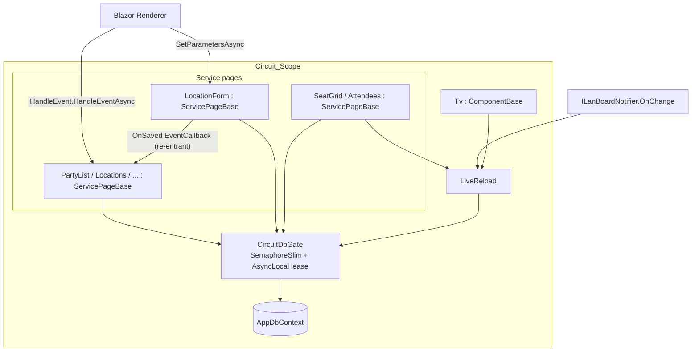
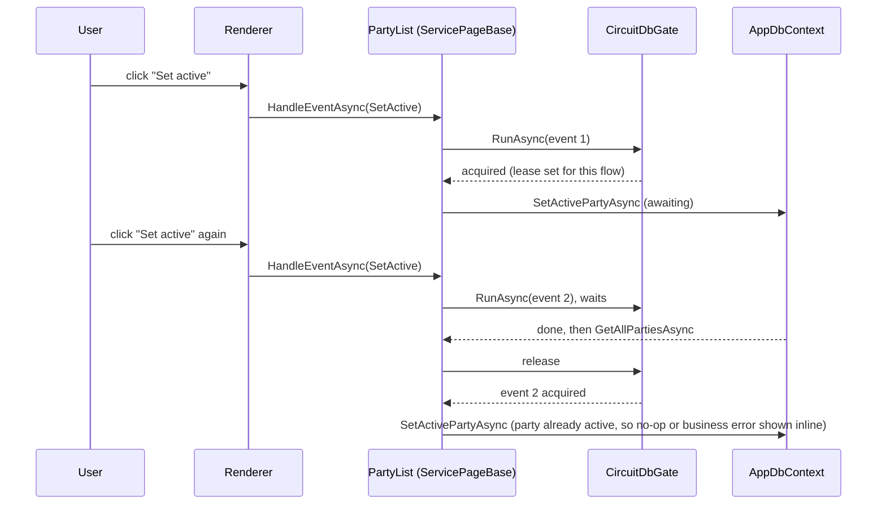

# Circuit DbContext Safety Design Document

## Overview

A new scoped service, `CircuitDbGate`, becomes the single lock for database work in a circuit (or prerender request) scope, so only one operation touches the scope's `AppDbContext` at a time. `ServicePageBase` routes every Blazor event (`IHandleEvent`) and every lifecycle run (`SetParametersAsync`) through the gate. Every page that inherits it is covered without per-page changes, including work outside `RunAsync` such as the reload in `PartyList.SetActive`. `LiveReload` drops its private serialisation chain and uses the same gate, so live reloads, page events and page loads can never overlap (R2.3). `ServicePageBase` also tracks its own in-flight gated work and waits for it on dispose (R3). It turns a leftover EF "second operation" error into an inline error instead of a circuit crash (R4). Switching to `IDbContextFactory` stays out of scope, as the requirements state.

## Architecture





**Key Architectural Principles:**

- **One lock per scope.** All DB-touching UI work in a circuit goes through `CircuitDbGate`. A per-component lock wouldn't cover `Locations` + `LocationForm` (R2.2) or `SeatGrid` + `LiveReload` (R2.3).
- **Covered by default.** The hook sits in `ServicePageBase` at the framework entry points (event dispatch, parameter set), not in page code (R2.1). Pages don't need busy flags for correctness (R2.4).
- **Re-entrant only along the awaited call chain.** Work that the current lease holder awaits (a child's `EventCallback` into its parent, `LiveReload.RunAsync` inside a gated event) passes straight through. New, independent work (a child's lifecycle triggered by a render, a live reload triggered by a notification) always queues. That rule avoids both deadlocks and overlaps.
- **Never outlive the scope.** Components wait for their own in-flight gated work on dispose and start nothing afterwards (R3).

## Components and Interfaces

### CircuitDbGate (new, `LanBoard.Web/Components/CircuitDbGate.cs`, registered `AddScoped`)

Serialises database work within one DI scope. Holds a `SemaphoreSlim(1, 1)` and a static `AsyncLocal<CircuitDbGate?>` that marks the current async flow as the lease holder.

```csharp
public sealed class CircuitDbGate
{
    /// True when the current async flow holds this gate's lease.
    public bool IsHeldByCurrentFlow { get; }

    /// Runs work under the lease.
    /// reentrant = true: if the current flow already holds the lease, runs work directly
    ///   (used for awaited call chains: EventCallbacks, LiveReload.RunAsync).
    /// reentrant = false: always waits for the lock (used for independent work:
    ///   lifecycle runs, notification-triggered reloads).
    /// Runs synchronously up to work's first await when the gate is free, so Blazor's
    /// intermediate render and prerender behave as before.
    /// Always releases the lock and restores the previous AsyncLocal value, also on exceptions.
    public Task RunAsync(Func<Task> work, bool reentrant);
}
```

### ServicePageBase (changed)

Becomes `ComponentBase, IHandleEvent, IAsyncDisposable`.

**Key Members:**

- `[Inject] CircuitDbGate Gate` (private)
- `Task IHandleEvent.HandleEventAsync(EventCallbackWorkItem callback, object? arg)`: re-implements `ComponentBase`'s event handling around `RunGatedAsync(() => callback.InvokeAsync(arg), reentrant: true)`. It keeps the framework semantics: `StateHasChanged()` after the synchronous part, and again after an incomplete task completes. Covers R1.1, R1.4 and R2.1, plus child→parent `EventCallback`s without deadlock (R2.2).
- `public override Task SetParametersAsync(ParameterView parameters)`: calls `parameters.SetParameterProperties(this)` synchronously (a `ParameterView` is only valid during the call), then `RunGatedAsync(() => base.SetParametersAsync(ParameterView.Empty), reentrant: false)`. Initial loads and parameter-driven reloads are thereby serialised with every other gated work, including a parent's in-flight load (R2.2).
- `private Task RunGatedAsync(Func<Task> work, bool reentrant)`: skips the work if the component is already disposed (R3.2). Registers the task in `_inFlight` and removes it on completion. Wraps the work in the handling described under Error Handling.
- `public async ValueTask DisposeAsync()`: sets `_disposed`, awaits `DisposeAsyncCore()`, then awaits all `_inFlight` tasks, swallowing their exceptions, which are already logged (R3.1).
- `protected virtual ValueTask DisposeAsyncCore()`: hook for subclasses. Replaces `SeatGrid`'s and `Attendees`' own `DisposeAsync`.
- Existing `RunAsync`/`RunAsync<T>` keep their signatures and behaviour; they now always run inside a gated event or lifecycle.

### LiveReload (changed)

Keeps the subscription lifetime, coalescing, logging and dispose-awaits-work behaviour from PR #47. Its private `ChainAsync` serialisation is replaced by the gate.

**Key Members:**

- Constructor gains `CircuitDbGate gate`: `LiveReload(ILanBoardNotifier, CircuitDbGate, Func<Func<Task>, Task> invokeAsync, Func<Task> reloadAsync, ILogger)`
- `Task RunAsync(Func<Task> work)` → `gate.RunAsync(work, reentrant: true)`, tracked for dispose. It stays for `Tv`, which isn't a `ServicePageBase`. `SeatGrid` and `Attendees` stop wrapping their handlers and loads in it, because the base class already gates them.
- On notification: sets `_pending`. If no drain loop is running, starts one (tracked, not awaited by the notifier). The drain loop runs `gate.RunAsync(reloadAsync, reentrant: false)` while `_pending && !_disposed`, so several notifications during busy work still coalesce into one reload. Because it's non-reentrant, a notification raised synchronously inside a gated mutation can't start a reload in the middle of that mutation.
- `DisposeAsync()`: unsubscribes, sets `_disposed`, awaits the tracked drain or run task.

### Page changes

| Component | Change |
|---|---|
| `SeatGrid`, `Attendees` | Drop `@implements IAsyncDisposable` and the `_live.RunAsync(...)` wrappers; override `DisposeAsyncCore` to dispose `_live`; pass `Gate` to `LiveReload` (exposed to subclasses as `protected CircuitDbGate Gate`) |
| `Tv` | `@inject CircuitDbGate Gate`, pass to `LiveReload`; otherwise unchanged |
| All other `ServicePageBase` pages | No change. `Settings` keeps `_saving` as optional UI feedback (R2.4) |
| `Program.cs` / `InfrastructureExtensions` | `builder.Services.AddScoped<CircuitDbGate>()` in the Web project |

## Data Models

There's no persisted data. The runtime state is:

```csharp
// CircuitDbGate, one per DI scope
SemaphoreSlim _lock = new(1, 1);                    // the single DB lease of the scope
static AsyncLocal<CircuitDbGate?> s_holder;         // which gate the current flow holds (null = none)

// ServicePageBase, one per component instance
bool _disposed;                                     // set first in DisposeAsync; checked before running gated work
HashSet<Task> _inFlight;                            // this component's gated tasks; awaited on dispose
```

**Invariants:**

- At most one non-re-entrant holder per scope at any time. Re-entrant runs only occur inside the current holder's awaited flow.
- `s_holder` is restored to its previous value when `RunAsync` exits, so leases never leak to later, unrelated work in the same flow.
- After `_disposed` is set, `RunGatedAsync` returns without running work.

## Error Handling

### Database errors in gated work

| Error Type | Condition | Recovery Strategy |
|------------|-----------|-------------------|
| Concurrency_Error | `InvalidOperationException` whose message starts with "A second operation was started on this context instance". Shouldn't happen with the gate; it's a safety net for work that escapes it | Catch in `RunGatedAsync`. Log at `Error` with the component type name (R4.2). Set `Error` to `Error.Generic` and call `StateHasChanged` (R4.3). Don't rethrow, so the circuit survives (R4.1) |
| Any exception after dispose | `_disposed` is true when the exception surfaces (for example `ObjectDisposedException`, `OperationCanceledException`, Npgsql errors from a torn-down scope) | Log at `Debug` and swallow (R3.3) |
| `PermissionDeniedException`, `BusinessRuleException`, `ValidationException` | Unchanged | Still handled inside `RunAsync` as today |
| Other exceptions while not disposed | Unchanged | Propagate to the renderer as today. Widening this is out of scope |

### Live reload errors

Unchanged from PR #47: reload failures log `Error`, and `OperationCanceledException`/`ObjectDisposedException` after dispose log `Debug`.

### Recovery Strategies

- **Automatic retry**: none. A queued second event simply runs after the first. For "Set active" that's a no-op or an inline business-rule message, not a crash.
- **Fallback state**: the page keeps its last rendered data plus the inline generic error.
- **User notification**: the existing inline `Error` area of `ServicePageBase` pages.

### Deadlock review

| Scenario | Why it can't deadlock |
|---|---|
| Child `LocationForm.SaveAsync` awaits `OnSaved` → parent `HandleEventAsync` | Same flow holds the lease, so the re-entrant call passes through |
| Parent event re-renders a child whose `SetParametersAsync` queues on the gate | The parent never awaits the child's lifecycle task; the renderer tracks it separately |
| `SeatGrid` mutation raises `OnChange` synchronously → `LiveReload` drain queues (non-reentrant) | The mutation doesn't await the drain; the drain runs after the event releases the lease |
| Component disposed during its own gated event (navigation inside the handler) | The renderer doesn't block the event on `DisposeAsync`; dispose waits for the event, not the reverse. Dispose never takes the gate |

## Testing Strategy

### Unit Tests (`LanBoard.Web.Tests/Components/CircuitDbGateTests.cs`, xUnit)

- `RunAsync` serialises two independent flows (second starts only after the first completes)
- A re-entrant call from inside the holder's flow runs immediately; a non-re-entrant call from inside waits
- An unrelated flow (`Task.Run`, separate `ExecutionContext`) never passes through re-entrantly
- The lock is released and the `AsyncLocal` restored when work throws
- Runs synchronously up to the first await when free

### Component Tests (bUnit, `LanBoard.Web.Tests/Components/ServicePageBaseTests.cs`)

Use small test components inheriting `ServicePageBase` and a fake service that records overlap, using the same `Track`/`TaskCompletionSource` pattern as `LiveReloadTests`.

- Two clicks on one button, the first blocked on a TCS: the handler runs twice, never concurrently (R1.1, R5.1)
- Parent and child `ServicePageBase` in one scope: the child's load waits for the parent's in-flight work; the child's `EventCallback` into the parent completes without deadlock (R2.2, R5.2)
- Dispose while work is in flight: `DisposeAsync` completes only after the work does (R3.1, R5.3); no handler runs after dispose (R3.2)
- Work throws a Concurrency_Error: no exception reaches the renderer, `Error` shows the generic message, and an `Error` log entry is written (R4)
- Work throws after dispose: a `Debug` log entry is written, no exception (R3.3)

### Updated Tests

- `LiveReloadTests`: pass a real `CircuitDbGate`. Existing cases keep their meaning (coalescing, `RunAsync` waits for a running reload, dispose waits). New: a reload waits for a gated `ServicePageBase`-style run held by another flow (R2.3).
- `PartyList` regression (bUnit): double-dispatch the "Set active" click while `SetActivePartyAsync` is blocked; assert no overlap on the fake `IAdminService`.
- Existing component tests (`PartyEdit*`, `PartyInfo`, …) must pass unchanged. They exercise the new `SetParametersAsync`/`HandleEventAsync` path implicitly.

### Integration / Smoke

- `scripts/double-click-smoke.mjs` (Playwright, run with `npx -y -p playwright node scripts/double-click-smoke.mjs [base-url] [runs]` against a running AppHost): logs in as `Alice`, double-dispatches "Set active" on `/admin/party` ≥ 30 times. It fails on a circuit-terminated console error or a non-200 `/`/`app.css` afterwards. The web log is checked for Concurrency_Error/Protocol_Error the same way as `scripts/prerender-abort-smoke.sh` (R1.2, R1.3, R5.4). It needs one active and one inactive party.
- Rerun `scripts/prerender-abort-smoke.sh` to confirm no regression of #44.

### Test Organization

- xUnit + bUnit + NSubstitute, in `LanBoard.Web.Tests/Components/`, named `*Tests.cs` as today

## Requirements Traceability

| Requirement | Covered by |
|---|---|
| R1.1–R1.4 | `HandleEventAsync` gating; PartyList regression test; double-click smoke |
| R2.1 | Hooks in `ServicePageBase` entry points, no page code |
| R2.2 | Scope-wide gate; non-re-entrant lifecycle; re-entrant `EventCallback` |
| R2.3 | `LiveReload` uses the same gate |
| R2.4 | Correctness doesn't depend on `disabled`/`_saving` |
| R3.1–R3.3 | `_inFlight` tracking, `_disposed` check, `Debug` logging after dispose |
| R4.1–R4.3 | Concurrency_Error catch in `RunGatedAsync` |
| R5.1–R5.4 | Gate, `ServicePageBase`, `LiveReload` and PartyList tests; double-click smoke script |

## Risks and Open Points

- **Re-implementing `IHandleEvent`.** `ServicePageBase` re-implements `ComponentBase`'s event handling, which is a small, stable framework contract. Tests pin the "render after sync part, render after completion" behaviour.
- **Queued UI-only events.** Events that don't touch the DB (opening a modal, toggling a confirm) also wait while a DB call is running. Calls take milliseconds, so this is acceptable, and it keeps event order.
- **`AsyncLocal` flow.** Correctness depends on the lease flowing into awaited calls and synchronous renders but not into unrelated events. That's standard `ExecutionContext` behaviour, and the gate tests pin it explicitly.
- **Pages outside `ServicePageBase`** (`Home`, `PartyInfo`, `PartyArchive`, `Stats`) aren't gated. `Home` finishes its load before `SeatGrid` exists. The others have no DB-backed event handlers. A comment in `ServicePageBase` will note that new DB-backed components should inherit it.
