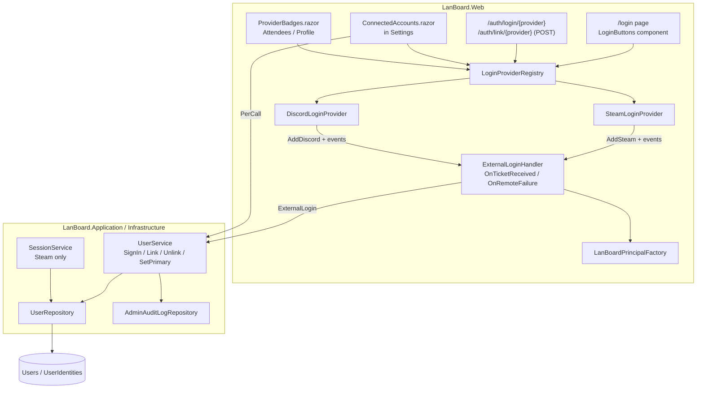
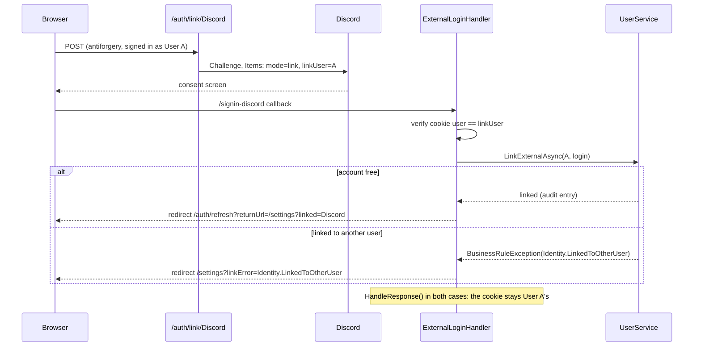

# External Login Providers Design Document

## Overview

Every external login runs through one provider-independent pipeline. Each External_Provider is a small `IExternalLoginProvider` class in `LanBoard.Web/Auth/Providers/`. The class registers its ASP.NET authentication handler and turns the handler's result into a neutral `ExternalLogin` record (provider key, provider user ID, Provider_Name, avatar URL). A shared `ExternalLoginHandler`, hooked into every handler's `OnTicketReceived` and `OnRemoteFailure` events, then signs the user in or links the account to the signed-in User. `UserService` owns the account rules (create, sync, link, unlink, primary) and keeps them provider-agnostic. Discord uses `AspNet.Security.OAuth.Discord`, from the same aspnet-contrib family as the existing Steam handler. It requests only the `identify` scope.

Provider_Name and avatar move from `User` onto `UserIdentity`. `User.DisplayName` and `User.AvatarUrl` stay as denormalized caches of the Effective_Name and the Primary_Identity's avatar, because they are used throughout the app (claims, ordering, nickname uniqueness, TV page). `User.SteamName` is removed.

**Rejected alternatives:**
- **ASP.NET Core Identity (`UserManager`, `AspNetUserLogins`).** It brings a second user store, password and lockout machinery LanBoard doesn't need, and a large migration away from the existing `User`/`UserIdentity` model, which already has the right shape.
- **Using the provider claims directly in the cookie.** Each provider sends different claim types, so pages would need provider-specific code again. This breaks Req 2.1/2.2.
- **Primary = first identity only, not selectable.** Simpler, but it contradicts the approved Req 3.5.

## Architecture





**Key Architectural Principles:**

- **Provider code stops at `ExternalLogin`.** Nothing after the mapping step knows which provider was used (Req 2.2). Adding a provider means one new `IExternalLoginProvider` class, one registry entry, an icon, and config.
- **The registry is the single source for the UI** (Req 2.1). Login buttons, Connected Accounts and badges iterate `LoginProviderRegistry.Enabled`.
- **Account rules live in the domain and the service, not in auth callbacks.** `User` enforces "one primary", "one identity per provider" and "never remove the last identity". `UserService` adds the cross-user checks and the audit log.
- **The cookie always holds LanBoard claims only.** The handler replaces the provider principal with one built by `LanBoardPrincipalFactory`, so `/auth/refresh` and permissions behave the same for every provider.

## Components and Interfaces

### Provider keys (`LanBoard.Application/Users/LoginProviders.cs`, new)

```csharp
public static class LoginProviders
{
    public const string Steam = "Steam";
    public const string Discord = "Discord";
    public const string Dev = "Dev";   // development login only, never in the registry
}
```
The key is also the authentication scheme name and the stored `UserIdentity.Provider` value. Existing rows already use `"Steam"`/`"Dev"`, so no data rewrite is needed.

### `ExternalLogin` (`LanBoard.Application/Users/ExternalLogin.cs`, new)

```csharp
public sealed record ExternalLogin(string Provider, string ProviderUserId, string ProviderName, string? AvatarUrl);
```

### `IExternalLoginProvider` (`LanBoard.Web/Auth/Providers/`, new)

```csharp
public interface IExternalLoginProvider
{
    string Key { get; }                    // = scheme name = UserIdentity.Provider
    string DisplayName { get; }            // "Steam", "Discord" (brand names are not localized)
    string IconPath { get; }               // "/steam-logo.svg", "/discord-logo.svg"
    bool IsConfigured(IConfiguration config);
    void AddScheme(AuthenticationBuilder auth, IConfiguration config, ExternalLoginHandler handler);
    string? ProfileUrl(string providerUserId);
}
```

- **`SteamLoginProvider`**: configured when `Steam:ApiKey` is non-empty. `AddScheme` calls `AddSteam(...)`. `OnTicketReceived` takes the SteamID from the `NameIdentifier` URL and the persona name from `ClaimTypes.Name`, loads the avatar via `ISteamApiClient` (the existing logic moves here), and builds the `ExternalLogin`. Profile URL: `https://steamcommunity.com/profiles/{id}`.
- **`DiscordLoginProvider`**: configured when `Authentication:Discord:ClientId` and `ClientSecret` are both non-empty. `AddScheme` calls `AddDiscord(o => { o.ClientId; o.ClientSecret; o.Scope.Clear(); o.Scope.Add("identify"); })`. Callback path is `/signin-discord`, which must be registered as the redirect URI in the Discord developer portal. The mapping reads the `/users/@me` payload (`id`, `username`, `global_name`, `avatar`) in `OnCreatingTicket` and stores the result in the ticket's `Items`, so it doesn't depend on the package's claim-type names:
  - `ProviderName = global_name ?? username`
  - `AvatarUrl = avatar is null ? $"https://cdn.discordapp.com/embed/avatars/{(id >> 22) % 6}.png" : $"https://cdn.discordapp.com/avatars/{id}/{avatar}.png?size=128"`
  - Profile URL: `https://discord.com/users/{id}`

Each provider exposes `Task<ExternalLogin?> MapAsync(TicketReceivedContext ctx)`, which the handler calls. `null` means the provider response was unusable.

### `LoginProviderRegistry` (`LanBoard.Web/Auth/LoginProviderRegistry.cs`, new, singleton)

```csharp
public sealed class LoginProviderRegistry(IEnumerable<IExternalLoginProvider> all, IConfiguration config)
{
    public IReadOnlyList<IExternalLoginProvider> Enabled { get; }      // registration order: Steam, Discord
    public IExternalLoginProvider? FindEnabled(string key);            // case-insensitive
    public IExternalLoginProvider? Find(string key);                   // for badges of disabled-but-linked providers
}
```
`AuthExtensions.AddAuth` instantiates the providers, adds a scheme only for configured ones (Req 2.3), and registers the registry. If no provider is enabled outside Development, it logs a warning at startup.

### `ExternalLoginHandler` (`LanBoard.Web/Auth/ExternalLoginHandler.cs`, new)

- `Task OnTicketReceivedAsync(TicketReceivedContext ctx, IExternalLoginProvider provider)`
  1. `provider.MapAsync(ctx)`. If that returns `null`, run the failure path with `Auth.ProviderError`.
  2. **Login mode** (no `Items["lanboard:mode"]`): `UserService.SignInExternalAsync(login)`. Then `ctx.Principal = LanBoardPrincipalFactory.Create(user, login)` and apply the preferred culture. The cookie handler signs in and redirects to the `RedirectUri`, which was already checked with `LocalUrl` (Req 1.5/1.6).
  3. **Link mode** (`Items["lanboard:mode"] = "link"`): authenticate the cookie scheme and check that its user ID equals `Items["lanboard:linkUser"]`. Then call `UserService.LinkExternalAsync(userId, login)`, `ctx.HandleResponse()`, and redirect to `/auth/refresh?returnUrl=/settings?linked={key}`. On `BusinessRuleException` the handler redirects to `/settings?linkError={code}`. The cookie is never replaced (Req 4.5, 7.3).
- `Task OnRemoteFailureAsync(RemoteFailureContext ctx)`: `ctx.HandleResponse()`.
  - If the user cancelled (Discord `error=access_denied`, OpenID cancel), redirect to the start page `Items["lanboard:returnUrl"]` (Req 7.1).
  - In link mode, redirect to `/settings?linkError=Auth.ProviderError`.
  - Otherwise, redirect to `/login?error=Auth.ProviderError&returnUrl=…` (Req 7.2).
  - Log the failure.

### `LanBoardPrincipalFactory` (`LanBoard.Web/Auth/`, new)

`ClaimsPrincipal Create(User user, string provider, string providerUserId)` builds the claims `Name` (Effective_Name), `NameIdentifier` (`{provider}:{providerUserId}`), `lanboard:userid`, `lanboard:avatarurl`, and `lanboard:provider` (the provider used for this login). Steam, Discord and dev login all use it, which removes the duplicated claim code in `AuthExtensions`/`DevAuthExtensions`.

### Endpoints (`AuthExtensions.MapAuthEndpoints`, replaces the inline mappings in `Program.cs`)

| Endpoint | Behavior |
|---|---|
| `GET /auth/login/{provider}?returnUrl=` | 404 if not `FindEnabled` (Req 2.4). Otherwise `Challenge(key)` with `RedirectUri = LocalUrl.IsLocal(returnUrl) ? returnUrl : "/"` and `Items["lanboard:returnUrl"]` |
| `POST /auth/link/{provider}` | `RequireAuthorization`, validates antiforgery, 404 if not enabled. Challenges with `Items` mode=link and linkUser=current user ID |
| `GET /auth/logout` | unchanged |
| `GET /auth/refresh` | unchanged |

The cookie options get `LoginPath = "/login"`, and `DefaultChallengeScheme` becomes the cookie scheme. Unauthenticated access to an `[Authorize]` page then lands on `/login?ReturnUrl=…` instead of being forced into Steam.

Linking is a POST with antiforgery. A GET link URL would let a third-party page silently attach an attacker-controlled provider account to a victim's session (login CSRF).

### `UserService` (extended, `IUserService`)

```csharp
Task<User> SignInExternalAsync(ExternalLogin login, CancellationToken ct = default);
Task LinkExternalAsync(Guid userId, ExternalLogin login, CancellationToken ct = default);
Task UnlinkAsync(Guid userId, string provider, CancellationToken ct = default);
Task SetPrimaryIdentityAsync(Guid userId, string provider, CancellationToken ct = default);
```
`GetOrCreateAndSyncSteamProfileAsync` is removed.

- **SignIn:** `FindByProviderAsync` returns the tracked user with identities. If found, call `user.SyncIdentity(...)`. Otherwise create the user with `AddIdentity` (first identity = primary). Then save. If a concurrent first login causes a unique violation, re-read and continue (Req 1.3/1.4, 3.2).
- **Link:** look up the owner of `(provider, providerUserId)`.
  - Owned by a different User: `Identity.LinkedToOtherUser`.
  - Owned by this User: sync only, no audit entry (Req 4.4).
  - The User already has a different account of the same provider: `Identity.ProviderAlreadyLinked` (Req 4.6).
  - Otherwise: `user.AddIdentity`, save, audit `IdentityLinked`.
- **Unlink:** `user.RemoveIdentity(provider)` throws `Identity.LastCannotUnlink` or `Identity.NotFound`. Then save and audit `IdentityUnlinked` (Req 5.1–5.5).
- **SetPrimary:** `user.SetPrimary(provider)`, then save.

The constructor gains `IAdminAuditLogRepository`.

### `User` domain methods (`LanBoard.Core/Entities/User.cs`)

```csharp
public UserIdentity AddIdentity(string provider, string providerUserId, string providerName, string? avatarUrl, DateTime now);
public void SyncIdentity(UserIdentity identity, string providerName, string? avatarUrl);
public void RemoveIdentity(string provider);   // last → InvalidOperationException; primary removed → oldest remaining becomes primary
public void SetPrimary(string provider);
public void SetNickname(string? nickname);     // existing, now refreshes from primary
private void RefreshDisplay();                 // DisplayName = Nickname ?? Primary.ProviderName; AvatarUrl = Primary.AvatarUrl
```
`SyncSteamName` is removed. Domain violations throw `InvalidOperationException`. `UserService` checks the preconditions first and throws `BusinessRuleException` with the matching code, so users never see the domain exception.

### Repository (`IUserRepository`)

- `FindByProviderAsync` now includes `Identities` (tracked).
- New `GetForUpdateWithIdentitiesAsync(Guid id)` (tracked).

### Read models and UI

- `ProfileView.SteamProfileUrl` is replaced by `IReadOnlyList<LinkedAccountView> Accounts`, with `LinkedAccountView(string Provider, string ProviderUserId, string ProviderName, bool IsPrimary)`. `ProfileSettings.SteamName` becomes `PrimaryProviderName` plus `Accounts`.
- **`ProviderBadges.razor`** (new): renders an icon, and a link where `ProfileUrl` is non-null, per linked account that the registry knows. Used on Attendees and Profile, replacing the Steam-only markup (Req 6.3).
- **`ConnectedAccounts.razor`** (new, Settings section): one row per enabled provider showing linked/not linked, the Provider_Name, and a "primary" marker.
  - Not linked: a "Connect" button as a plain `<form method="post" action="/auth/link/{key}">` with `<AntiforgeryToken/>`.
  - Linked: "Disconnect" and "Make primary" buttons via `PerCall<IUserService>`, followed by a forced navigation to `/auth/refresh?returnUrl=/settings`, the same pattern as the nickname save.
  - Disconnect is disabled for the only identity.
  - Shows `linked`/`linkError` from the query string.
- **`/login` page** (new, static SSR) and **`LoginButtons.razor`**: one button per enabled provider, used by `/login`, Home and NavMenu (Req 1.1/1.2). It shows the `error` query message.
- **Steam features** (Req 6.1/6.2):
  - `SteamConfiguration.ApiKey` loses `[Required]`.
  - `SessionPollingService` skips polling when Steam is not configured.
  - `SessionService` keeps filtering on `LoginProviders.Steam`, so users without Steam simply never get a session.
  - Profile "played games" stays and is empty for non-Steam users.

### Dev login

`DevAuthExtensions` keeps its endpoint and allow-list. It now calls `SignInExternalAsync(new ExternalLogin("Dev", name, name, null))` and `LanBoardPrincipalFactory` instead of building the user and claims itself. Behavior is unchanged (Req 2.5).

## Data Models

### `UserIdentity` (extended)

```csharp
public class UserIdentity
{
    public Guid Id { get; set; }
    public Guid UserId { get; set; }
    public required string Provider { get; set; }        // max 50, registry key
    public required string ProviderUserId { get; set; }  // max 200
    public required string ProviderName { get; set; }    // NEW, max 100, non-empty
    public string? AvatarUrl { get; set; }               // NEW, max 500
    public bool IsPrimary { get; set; }                  // NEW
    public DateTime CreatedAt { get; set; }              // "oldest remaining" = min CreatedAt
    public DateTime? LastLoginAt { get; set; }           // NEW, set on each sign-in through this identity
}
```

### `User` (changed)

`SteamName` is removed. `DisplayName` (Effective_Name cache) and `AvatarUrl` (Primary_Identity avatar cache) stay and are only written by `RefreshDisplay`.

**Validation rules:**
- `ProviderName`: trimmed and truncated to 100. An empty value falls back to `ProviderUserId`, because provider names can be blank.
- `AvatarUrl`: must be an absolute `https` URL ≤ 500 characters, otherwise stored as `null`.
- `(Provider, ProviderUserId)`: unique (existing index).
- `(UserId, Provider)`: unique, new index (Req 4.6).
- `(UserId) WHERE IsPrimary`: unique filtered index (`"IsPrimary" = true`), so there is at most one primary per User.
- A User always has ≥ 1 identity and exactly 1 primary. The domain enforces this; the filtered index backs it.

### Migration `ExternalLoginProviders`

1. Add `ProviderName` (nullable at first), `AvatarUrl`, `IsPrimary` (default `false`) and `LastLoginAt` to `UserIdentities`.
2. Copy the existing values. Every existing user has exactly one identity, Steam or Dev:
   `UPDATE "UserIdentities" i SET "ProviderName" = u."SteamName", "AvatarUrl" = u."AvatarUrl", "IsPrimary" = true FROM "Users" u WHERE u."Id" = i."UserId";`
3. Make `ProviderName` non-nullable and create both new indexes.
4. Drop `Users.SteamName`.

`Down` re-adds `SteamName` from the primary identity's `ProviderName`. `DisplayName`, `Nickname` and `AvatarUrl` on `Users` are untouched, so existing Steam users look exactly the same (Req 3.6).

### Configuration

```json
{
  "Steam": { "ApiKey": "" },
  "Authentication": { "Discord": { "ClientId": "", "ClientSecret": "" } }
}
```
Secrets go in user secrets or environment variables (`Authentication__Discord__ClientSecret`), never in `appsettings.json`.

### Localization (en + de resx)

- `Nav.LoginWithSteam` is replaced by `Login.With` ("Login with {0}" / "Mit {0} anmelden").
- New keys: `Login.Title`, `Settings.Section.ConnectedAccounts`, `Settings.Accounts.Connect`, `.Disconnect`, `.MakePrimary`, `.Primary`, `.Linked`, `Audit.IdentityLinked`, `Audit.IdentityUnlinked`, plus messages for the new error codes.

## Error Handling

### Business rule errors (`ErrorCodes`, localized)

| Error Code | Condition | Handling |
|---|---|---|
| `Identity.LinkedToOtherUser` | Link target account belongs to another User | Settings banner, nothing changed (Req 4.3) |
| `Identity.ProviderAlreadyLinked` | User already has a different account of that provider | Settings banner, nothing changed (Req 4.6) |
| `Identity.LastCannotUnlink` | Unlinking the only identity | Button disabled in the UI; the service still rejects (Req 5.2) |
| `Identity.NotFound` | Unlink/SetPrimary for a provider the User doesn't have | Settings banner |
| `Auth.ProviderError` | Provider returned an error, or the mapping returned `null` | `/login` banner (login) or Settings banner (link) (Req 7.2/7.3) |
| `Auth.LinkSessionMismatch` | Cookie user at the callback ≠ user who started the link | Settings banner, nothing linked |

### Request errors

| Condition | Response |
|---|---|
| Unknown or disabled provider key on `/auth/login/{p}` or `/auth/link/{p}` | 404 (Req 2.4) |
| Non-local `returnUrl` | Treated as `/` (Req 1.6) |
| Missing or invalid antiforgery token on link | 400 |
| Link while signed out | Cookie challenge → `/login` |

### Recovery strategies

- **Concurrent first login** (unique violation on `(Provider, ProviderUserId)`): re-read the user and continue the sign-in.
- **Cancelled consent:** silent return to the start page, no banner (Req 7.1).
- **Steam API unavailable during login:** the avatar is `null` and the previous avatar is kept. Login does not fail (existing `GetAvatarUrlAsync` behavior).
- **Provider disabled after users linked it:** existing identities and badges stay. The provider just has no login or connect button. Users with only that identity can't log in until it is re-enabled. This is an operator decision and is logged at startup.

## Testing Strategy

### Unit tests (`LanBoard.Infrastructure.Tests`, xUnit + NSubstitute)

- **`UserTests`:**
  - The first identity is primary.
  - `SetPrimary` switches the name and avatar.
  - Removing the primary promotes the oldest remaining identity.
  - Removing the last identity throws.
  - The nickname wins over the Provider_Name.
  - `SyncIdentity` on a non-primary identity leaves `DisplayName`/`AvatarUrl` unchanged.
- **`UserServiceTests`:**
  - SignIn creates a new user, or syncs and sets `LastLoginAt` for an existing one.
  - Link: success with audit entry; other-user conflict; same-user no-op; second account of the same provider.
  - Unlink: success with audit entry; last identity rejected; unknown provider.
  - SetPrimary.
  - Concurrent-create retry.
- **`DiscordLoginProvider` mapping:** `global_name` fallback to `username`; custom avatar URL; default avatar index; empty name falls back to the ID.

### Web tests (`LanBoard.Web.Tests`)

- **`LoginProviderRegistryTests`:** enabled only when configured; `FindEnabled` is case-insensitive; the order is stable.
- **`AuthEndpointTests`:** unknown provider → 404; a non-local `returnUrl` becomes `/`; link without antiforgery → 400; link sets the mode/linkUser items. Same style as `AuthRefreshEndpointTests`.
- **`ExternalLoginHandlerTests`:**
  - The login mode replaces the principal with LanBoard claims.
  - The link mode never replaces the cookie and redirects with `linked`/`linkError`.
  - Session mismatch is rejected.
  - Cancel → return URL; error → `/login?error=`.
- **bUnit:** `ConnectedAccounts` (Disconnect disabled for a single identity, primary marker, link-error banner) and `ProviderBadges` (link only where `ProfileUrl` is non-null, unknown providers skipped).
- The existing `ResourceParityTests`, `KeyUsageTests` and `CatalogCoverageTests` cover the new resx keys and audit actions automatically.

### Manual verification

Run the Discord login against a real Discord application (redirect URI `https://localhost:<port>/signin-discord`): new user, re-login, link to an existing Steam user, cancel on the consent screen, and unlink.
