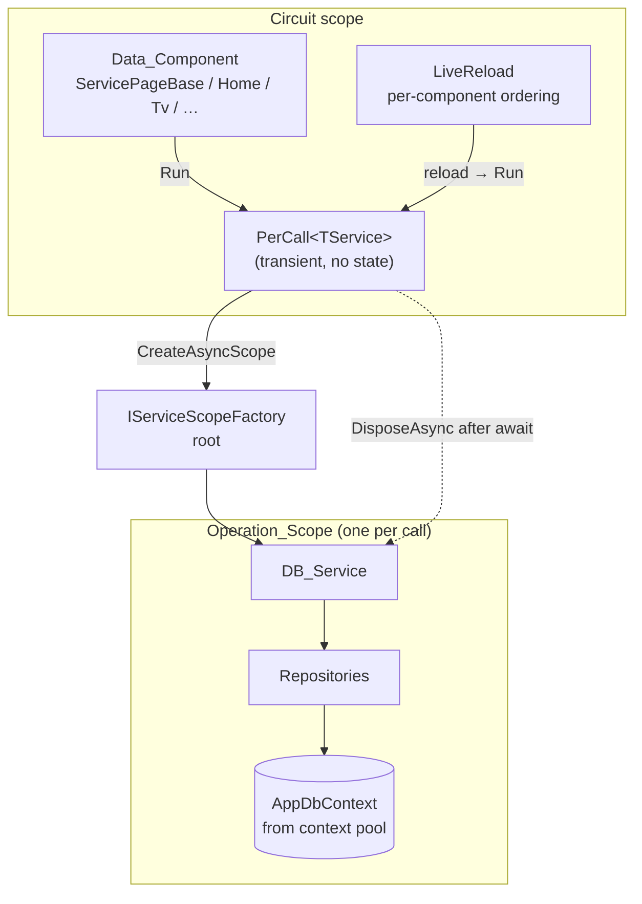
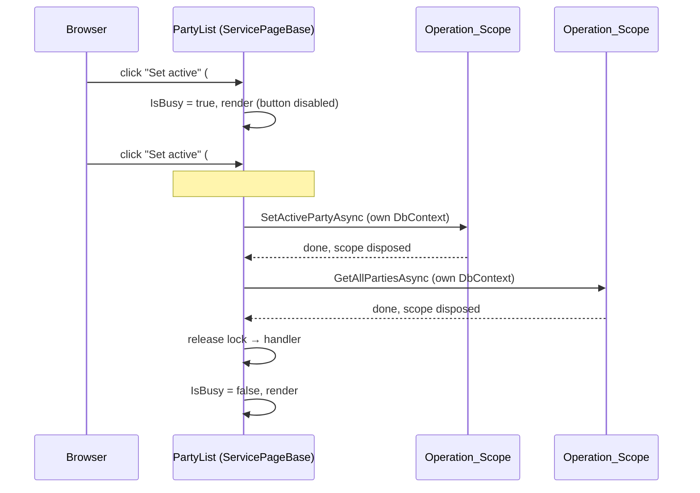

# Per-Operation DbContext Design Document

## Overview

Components stop injecting DB_Services from the circuit scope. Instead they inject **`PerCall<TService>`**, a small Web-side wrapper. Every call through it creates an `AsyncServiceScope` from `IServiceScopeFactory`, resolves the service there, awaits the call and disposes the scope. Each Page_Operation therefore gets its own `AppDbContext` (rented from the EF context pool that `AddNpgsqlDbContext` registers), which is the Microsoft-recommended pattern for Blazor Server. `SessionPollingService` already works this way.

This works without touching Application/Infrastructure because the services carry no circuit state. They don't depend on `AuthenticationStateProvider`, `HttpContext` or other circuit-scoped services: the acting user comes in as `performedByUserId`, `PermissionService` doesn't cache, and there's no lazy loading and no `Attach`/`Update` of detached entities.

`ServicePageBase` additionally re-implements `IHandleEvent` to order a page's own user events, maintain `IsBusy`, and contain unexpected exceptions.

**Rejected alternatives:**
- **`IDbContextFactory` inside Infrastructure.** Every service and repository would have to create the context itself, and repositories would lose the shared unit of work within one service call. That's 16 files rewritten for the same effect.
- **`OwningComponentBase`.** It gives one scope per component, so a double-click and live reloads within one component would still share a context.
- **A circuit-wide gate (previous design).** It treats the symptom, keeps stale tracking, and needs re-entrancy logic.

## Architecture





**Key Architectural Principles:**

- **A context lives exactly as long as one service call.** Circuit and prerender disposal never touch a context that is in use (Req 1, 3). This also removes the reason for the tracking-staleness workaround.
- **Isolation is enforced, not just provided.** An architecture test forbids injecting DB_Services directly into components (Req 5.2).
- **Ordering is per component.** The event lock is per Service_Page and `LiveReload` stays per component. Different components run in parallel on separate contexts, which is safe.
- **The busy state is UX only** (Req 6.5).

## Components and Interfaces

### `PerCall<TService>` (new, `LanBoard.Web/Services/PerCall.cs`)

```csharp
/// Runs each call on a fresh DI scope, so every operation gets its own DbContext.
public sealed class PerCall<TService>(IServiceScopeFactory scopeFactory) where TService : notnull
{
    public async Task<TResult> Run<TResult>(Func<TService, Task<TResult>> call)
    {
        await using var scope = scopeFactory.CreateAsyncScope();
        return await call(scope.ServiceProvider.GetRequiredService<TService>());
    }

    public async Task Run(Func<TService, Task> call) { /* same, no result */ }
}
```

- Registration in `Program.cs`: `builder.Services.AddTransient(typeof(PerCall<>));`
- Usage: `@inject PerCall<IAdminService> AdminService`, then `await AdminService.Run(s => s.GetAllPartiesAsync())`.
- Type inference works from the lambda, the diff per call site is mechanical, and the injected property name stays the same.
- **Granularity:** one call is one scope. A load that calls several services (`Attendees.LoadAsync`: 4 reads) uses several short contexts. Consistency doesn't get worse: a shared `DbContext` never gave a snapshot, because without an explicit transaction each query runs as its own statement under Read Committed. The extra cost is 3 additional context rentals from the pool per load, which is negligible. If a page ever needs a consistent snapshot or a combined query, it gets a composed read method in Application (e.g. `IAttendeeService.GetBoardAsync(partyId)` returning a read-model record, implemented in Infrastructure with one context, optionally in a `RepeatableRead` transaction). Not part of this change.
- **No cancellation token**, per the CLAUDE.md rule.

### `ServicePageBase` (changed)

```csharp
public abstract class ServicePageBase : ComponentBase, IHandleEvent, IAsyncDisposable
{
    protected bool IsBusy { get; private set; }                 // Req 6
    public override Task SetParametersAsync(ParameterView parameters);
    Task IHandleEvent.HandleEventAsync(EventCallbackWorkItem callback, object? arg);
    public ValueTask DisposeAsync();
    protected virtual ValueTask DisposeAsyncCore();             // SeatGrid / Attendees cleanup

    // unchanged: CurrentUserIdAsync, RunAsync(Func<Task>), RunAsync<T>, Error, ValidationErrors
}
```

**`IHandleEvent.HandleEventAsync`**: a C# interface re-implementation that replaces `ComponentBase`'s explicit one.
1. `await _eventLock.WaitAsync()`, a per-instance `SemaphoreSlim(1, 1)` (Req 2.1). If the lock isn't free immediately, set `IsBusy = true` and render first, so a queued click also shows the disabled state.
2. If `_disposed`, release and return (Req 3.2).
3. Call `var task = callback.InvokeAsync(arg)`. If the task isn't completed: `IsBusy = true`, `StateHasChanged()`, `await task`.
4. Catch unexpected exceptions → `Contain(ex)` (see below).
5. `finally`: `IsBusy = false`, release the lock, `StateHasChanged()` unless disposed.

Synchronous handlers (`_confirmDeleteId = id`, `@bind` changes) never set `IsBusy`, so there's no flicker (Req 6.4).

Deadlock note: a handler that awaits an `EventCallback` targeting the **same** component would wait on its own lock. That doesn't happen today. `LocationForm` → parent `OnSaved` is a different component and has a different lock. It's documented in the XML doc.

**`SetParametersAsync`**: a `ParameterView` is only valid synchronously.
1. `parameters.SetParameterProperties(this)`.
2. `try { await base.SetParametersAsync(ParameterView.Empty); } catch (Exception ex) { Contain(ex); }`

This contains errors from `OnInitialized(Async)` and `OnParametersSet(Async)` (Req 4.1).

**`Contain(Exception ex)`** (private):
- if `_disposed`: `LogDebug` and return (Req 3.3)
- else: `Logger.LogError`, `Error = L["Error.Generic"]`, `StateHasChanged()` (Req 4.1–4.3; the key already exists)
- Domain exceptions never get here. They are still mapped inside `RunAsync` (Req 4.4).

**`DisposeAsync`**: sets `_disposed = true`, then calls `DisposeAsyncCore()`. It doesn't wait for in-flight work, because no shared context is at risk any more (Req 3.1). In-flight handlers finish on their own Operation_Scope, and their `StateHasChanged` is skipped.

### `LiveReload` (unchanged API, doc change)

It keeps its per-component chain and coalescing, which provides ordering (Req 2.4) and stops reloads after dispose. The XML doc changes from "protects the circuit's DbContext" to "orders a component's loads and live reloads". `SeatGrid`'s `_live.RunAsync` wrappers around handlers stay, because they order a mutation against concurrent reloads of the same grid. That's a different job from the event lock.

### Data_Components (call-site migration)

| Component | Change |
|---|---|
| All 16 `ServicePageBase` pages + `LocationForm` | `@inject IXxxService X` → `@inject PerCall<IXxxService> X`; calls `X.Foo(a)` → `X.Run(s => s.Foo(a))` |
| `Home`, `Tv`, `Stats`, `PartyArchive`, `PartyInfo` | Same migration. They stay `ComponentBase` (read-only, no `ErrorBanner`), so Req 4 applies to Service_Pages only |
| Pages with Action_Controls | `disabled="@IsBusy"`, combined with existing conditions, e.g. `disabled="@(IsBusy \|\| !_canManage)"` |
| `Settings` | `_saving` → `IsBusy` (Req 5.3) |
| `SeatGrid`, `Attendees` | `DisposeAsync` → `override DisposeAsyncCore` |
| `Styles/app.css` | `button:disabled, input[type=submit]:disabled { @apply opacity-50 cursor-not-allowed; }` (Req 6.3) |
| `CLAUDE.md` › Blazor Data Loading | Replace the "scoped DbContext must never be in use while its scope is disposed" rule with "components use `PerCall<T>`; never inject DB_Services directly" |

Infrastructure, Application and the DI registrations stay unchanged (Req 5.4). HTTP endpoints (dev login, claims transformation) keep using the request scope, which is correct there.

`AsNoTracking` in repositories stays: it's still cheaper for reads. The memory note about tracking staleness gets updated after the merge.

## Data Models

No persistence changes and no migrations.

| Member | Type | Rules |
|---|---|---|
| `ServicePageBase.IsBusy` | `bool` | true only while a user-event handler waits for the lock or awaits async work; reset in `finally` |
| `ServicePageBase._eventLock` | `SemaphoreSlim(1,1)` | per instance; never disposed explicitly (no wait handle allocated) |
| `ServicePageBase._disposed` | `bool` | set once, first statement of `DisposeAsync` |

## Error Handling

| Category | Example | Handling |
|---|---|---|
| Expected domain error | `PermissionDeniedException`, `BusinessRuleException`, `ValidationException` | Unchanged: `RunAsync` → inline `Error` / `ValidationErrors` |
| Second click on a missing target | second "Delete" | Service throws its normal not-found error → same inline message (Req 2.3). Each delete path is checked during implementation; any that throws something else is mapped to the existing not-found error code |
| Unexpected exception (handler or lifecycle) | `DbUpdateException`, `NpgsqlException`, bug | `Contain`: `LogError` + `Error.Generic` banner, circuit alive |
| Completion after dispose | handler finishes after tab close | `LogDebug`, no render |
| Live reload failure | as before | `LiveReload.LogFailure` unchanged |
| Read-only `ComponentBase` pages | exception in `Home` load | Unchanged (error UI). Acceptable: no mutations, and a reload retries |

**Recovery:**
- After an error, the page keeps its last state plus the banner, and buttons are re-enabled, so the user can retry.
- If a lifecycle load fails, the banner shows next to "Loading…".
- The Operation_Scope is always disposed (`await using`), so a failed call never leaks a context or connection.

## Testing Strategy

**Unit tests** (`LanBoard.Web.Tests`, xUnit + bUnit + NSubstitute):

- `PerCallTests` (with a real `ServiceCollection` and a scoped fake service that counts instances and disposals):
  - two calls → two instances
  - scope disposed after success
  - scope disposed after exception (Req 7.1)
  - overlapping calls get distinct instances (Req 1.4)
- `ServicePageBaseTests` (bUnit test component deriving from `ServicePageBase`; handlers block on `TaskCompletionSource`):
  - two clicks → second handler starts after the first completes (Req 2.1)
  - `IsBusy` true while pending, false after success and after failure (Req 6.1, 6.2, 7.3)
  - queued click shows `IsBusy`
  - synchronous handler and initial load never set `IsBusy` (Req 6.4)
  - unexpected exception in handler and in `OnInitializedAsync` → `Error.Generic`, `LogError`, renderer has no unhandled exception (Req 4)
  - domain exceptions unchanged
  - queued handler doesn't run after dispose (Req 3.2)
  - exception after dispose → `LogDebug` only (Req 3.3)
  - child component awaiting a parent `EventCallback` completes (no deadlock)
- `ComponentInjectionTests` (architecture test, Req 5.2): reflect over all `IComponent` types in `LanBoard.Web` and fail for every `[Inject]` property whose type is an interface from `LanBoard.Application` whose implementation is registered by `AddInfrastructure` (determined by building that `ServiceCollection`).
- `LiveReloadTests`: unchanged.

**Smoke check** (Req 7.4–7.6): `scripts/double-click-smoke/`, a Node + Playwright script with its own `package.json`. A bash wrapper reads `aspire logs web` like `prerender-abort-smoke.sh`:
1. Dev-login as Alice, open `/admin/party` with ≥ 2 parties.
2. 30× dispatch two `click` events on "Set active" in the same tick via `page.evaluate`.
3. After each run, assert no `#blazor-error-ui` / reconnect banner.
4. Count `second operation`, `ArgumentOutOfRangeException` and `Exception while reading from stream` in the new log lines; exit non-zero on any hit.
5. Run `prerender-abort-smoke.sh` as a regression check for #44.
