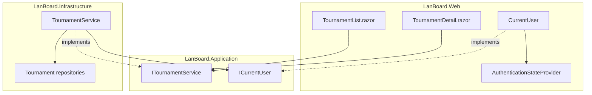
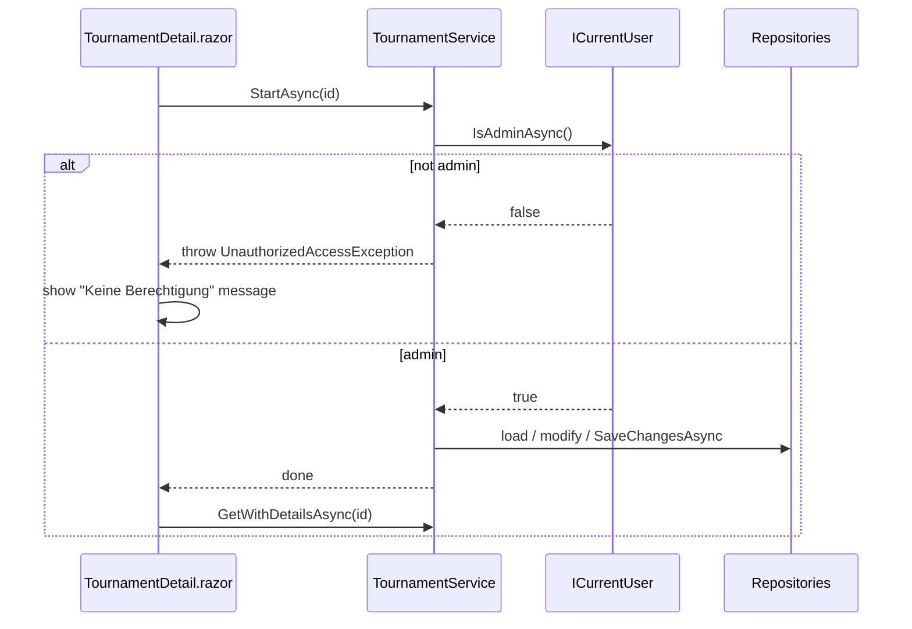

# Tournament Admin Authorization Design Document

## Overview

The admin check moves into `TournamentService` itself, so every caller (today the two Blazor pages, tomorrow anything else) goes through it. Because `LanBoard.Infrastructure` and `LanBoard.Application` have no ASP.NET Core dependency, the service can't read claims directly. Instead, a small `ICurrentUser` abstraction is added to `LanBoard.Application`, implemented in `LanBoard.Web` on top of `AuthenticationStateProvider`, and injected into `TournamentService`. Every mutating method calls a private `EnsureAdminAsync()` as its first statement and throws `UnauthorizedAccessException` for non-admins. The pages catch that exception and show a message instead of tearing down the circuit.

`CreateAsync` is included as a Mutating_Operation: `TournamentList.razor` only hides the create form with `<AuthorizeView Policy="Admin">`, so it has the same hole as the four methods named in #18 (resolves the first open question from the requirements). Rejected attempts are not audit-logged (second open question, as agreed).

## Architecture





**Key Architectural Principles:**

- **Enforce at the service boundary** — the UI check stays for UX only; the service is the security boundary (Req 1).
- **Identity from the server, never from parameters** — the service asks `ICurrentUser`; no `isAdmin`/`userId` argument is accepted from the page (Req 2.2).
- **Check before any I/O** — `EnsureAdminAsync()` runs before the first repository call, so a rejected call touches nothing (Req 1.2, 1.4).
- **One definition of admin** — `lanboard:isadmin == "true"`, the same claim the `"Admin"` policy in `AuthExtensions.cs` requires (Req 2.1).

## Components and Interfaces

### ICurrentUser (new, `LanBoard.Application/Users/ICurrentUser.cs`)

```csharp
public interface ICurrentUser
{
    /// True when the current principal is authenticated and has lanboard:isadmin = "true".
    Task<bool> IsAdminAsync(CancellationToken ct = default);
}
```

Kept minimal on purpose. It's async because `AuthenticationStateProvider.GetAuthenticationStateAsync()` is async. Further members (e.g. `UserId`) can be added when another service needs them.

### CurrentUser (new, `LanBoard.Web/Services/CurrentUser.cs`)

```csharp
public sealed class CurrentUser(AuthenticationStateProvider auth) : ICurrentUser
{
    public async Task<bool> IsAdminAsync(CancellationToken ct = default)
    {
        var state = await auth.GetAuthenticationStateAsync();
        return state.User.Identity?.IsAuthenticated == true
            && state.User.HasClaim("lanboard:isadmin", "true");
    }
}
```

- Registered as **scoped** in `AddAuth()` (`LanBoard.Web/Extensions/AuthExtensions.cs`) via `builder.Services.AddScoped<ICurrentUser, CurrentUser>()`, so it shares the circuit's `AuthenticationStateProvider`.
- Unauthenticated principal → `false` (Req 2.3).
- The claim name/value is pulled into a shared constant (e.g. `AdminClaim.Type` / `AdminClaim.Value` in `LanBoard.Web/Extensions/AuthExtensions.cs`) and reused by the `"Admin"` policy, `DevAuthExtensions`, `NavMenu` and `TournamentDetail`, so the definition can't drift (Req 2.1).

### TournamentService (changed)

New constructor dependency: `ICurrentUser currentUser`.

```csharp
private async Task EnsureAdminAsync(CancellationToken ct)
{
    if (!await currentUser.IsAdminAsync(ct))
        throw new UnauthorizedAccessException("Only admins can modify tournaments.");
}
```

| Method | Change |
|--------|--------|
| `CreateAsync` | `await EnsureAdminAsync(ct);` as first line |
| `AddParticipantAsync` | `await EnsureAdminAsync(ct);` as first line |
| `RemoveParticipantAsync` | `await EnsureAdminAsync(ct);` as first line |
| `StartAsync` | `await EnsureAdminAsync(ct);` as first line |
| `SetMatchWinnerAsync` | `await EnsureAdminAsync(ct);` as first line |
| `GetByPartyAsync`, `GetWithDetailsAsync` | unchanged — no check (Req 3.1) |

`ITournamentService` signatures do not change.

### TournamentDetail.razor (changed)

- `_isAdmin` stays and still drives which controls render (Req 3.2).
- `ToggleParticipantAsync`, `StartAsync`, `SetWinnerAsync` wrap the service call in `try { … } catch (UnauthorizedAccessException) { _error = "Keine Berechtigung für diese Aktion."; }`, then reload (Req 4.1, 4.2).
- A dismissible error banner renders when `_error` is set (same Tailwind style as the rest of the page, e.g. red-tinted `bg-red-900/40 border-red-700`).

### TournamentList.razor (changed)

- `CreateAsync` gets the same `try/catch (UnauthorizedAccessException)` and `_error` banner.

## Data Models

No entity, schema or migration changes. The only new "model" is the admin claim constant:

```csharp
public static class AdminClaim
{
    public const string Type = "lanboard:isadmin";
    public const string Value = "true";
}
```

**Validation Rules:**

- Admin ⇔ principal authenticated **and** has a claim with `Type == "lanboard:isadmin"` and `Value == "true"` (exact, case-sensitive match as `HasClaim` does today).

## Error Handling

### Authorization

| Error Type | Condition | Recovery Strategy |
|------------|-----------|-------------------|
| `UnauthorizedAccessException` | Non_Admin calls a Mutating_Operation | Service throws before any repository call; page catches, shows "Keine Berechtigung für diese Aktion.", reloads tournament state, circuit stays alive |

`UnauthorizedAccessException` (BCL) is used rather than a custom type: it's the conventional .NET signal for this, needs no new dependency in Application/Infrastructure, and is distinct from the `InvalidOperationException`s the service already throws for domain rule violations (so the page doesn't accidentally swallow those).

### Existing domain errors

Unchanged. `InvalidOperationException` ("Tournament not found", "already started", …) behaves exactly as today. Because the admin check runs first, a non-admin always gets `UnauthorizedAccessException`, never a domain error that might leak tournament state.

### Recovery Strategies

- **Automatic Retry**: none — an authorization failure is not transient.
- **Fallback State**: page reloads the tournament from the service, so the UI reflects the real (unchanged) state, e.g. a checkbox ticked via devtools snaps back.
- **User Notification**: German inline banner, matching the rest of the UI.

## Testing Strategy

### Unit Tests (`LanBoard.Infrastructure.Tests/Services/TournamentServiceTests.cs`)

The test class gets an `ICurrentUser` substitute. The constructor defaults it to admin (`IsAdminAsync` returns `true`) so all existing tests keep passing unchanged (Req 1.3, 5.3 — the existing happy-path tests become the "admin succeeds" proof).

New tests, one per Mutating_Operation, as a `[Theory]` or individual `[Fact]`s:

- `<Method>_NotAdmin_ThrowsUnauthorizedAccess` — `IsAdminAsync` returns `false`; assert `UnauthorizedAccessException` (Req 5.1).
- `<Method>_NotAdmin_DoesNotTouchRepositories` — assert no `AddAsync`, `Remove`, `SaveChangesAsync` on any repository (`DidNotReceiveWithAnyArgs`), and no reads either, proving the check runs first (Req 1.2, 1.4, 5.2).
- `GetWithDetailsAsync_NotAdmin_ReturnsTournament` and `GetByPartyAsync_NotAdmin_Returns…` — read operations still work for non-admins (Req 3.1).

### CurrentUser Tests

`LanBoard.Web` has no test project today. `CurrentUser` is three lines over a framework type, so it's covered by:

- a quick manual check (below), and
- **optionally** a new `LanBoard.Web.Tests` project with tests for admin / non-admin / unauthenticated principals. Not required by the requirements; recommend skipping unless you want the project added.

### Manual Verification

- Log in as non-admin (dev auth), open a not-yet-started tournament, remove `disabled` from a checkbox in devtools, click it → banner appears, checkbox reverts, DB unchanged.
- Log in as admin → add/remove participants, start, set winners all work as before.

### Test Organization

- Framework: xUnit + NSubstitute (existing)
- Location: `LanBoard.Infrastructure.Tests/Services/TournamentServiceTests.cs` (existing file)
- Run: `dotnet test`

## Requirements Traceability

| Requirement | Covered by |
|-------------|-----------|
| 1.1–1.4 | `EnsureAdminAsync` first in each mutating method; unit tests |
| 2.1 | `AdminClaim` constant shared with `"Admin"` policy |
| 2.2 | `ICurrentUser` backed by `AuthenticationStateProvider`; no client-supplied flags |
| 2.3 | `IsAuthenticated` check in `CurrentUser` |
| 3.1 | Read methods unchanged; unit tests |
| 3.2 | `_isAdmin` UI gating kept |
| 4.1–4.2 | `try/catch` + error banner in both pages |
| 5.1–5.3 | New non-admin tests; existing tests run as admin |
